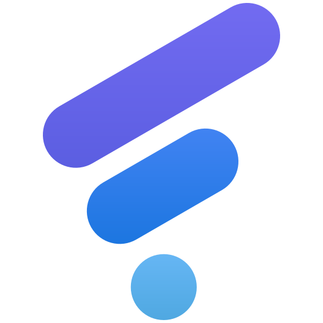
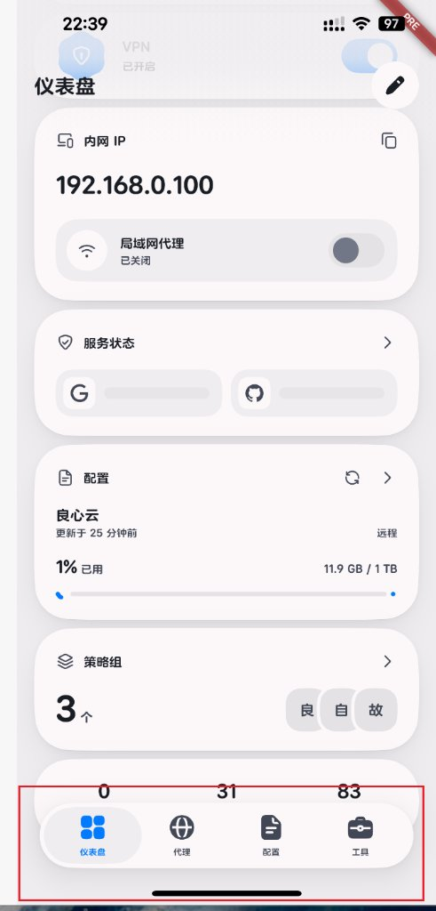
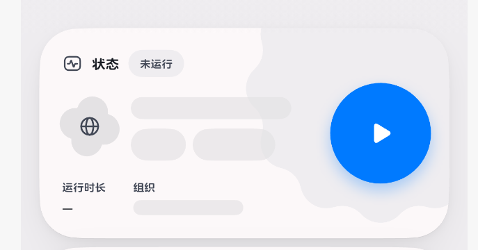
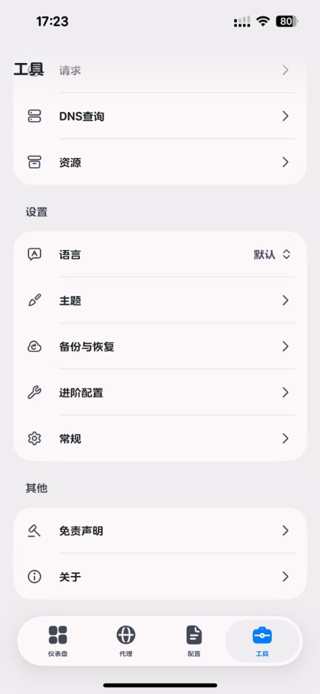
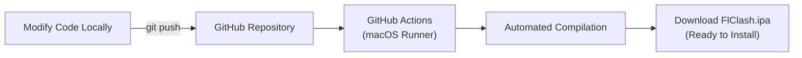

# FlClash for iOS

### Next-Generation High-Performance Proxy Client Tailored for iOS

Powered by **Mihomo (Clash.Meta)** core and **Flutter** modern architecture. Clean, open-source, ad-free, ultra-fast, and memory-optimized.

**English** · [简体中文](README_zh_CN.md)

 

 

[📱 Screenshots](#-screenshots) · [✨ Features](#-key-features) · [📥 Installation](#-installation-guide) · [🌐 Protocol Matrix](#-protocol-support-matrix) · [🛠️ CI/CD Build](#️-cloud-automated-build-cicd)

---

## 📱 Screenshots

  <table border="0">
    <tr>
      <td align="center" width="33%">
        
         
        <b>Dashboard & Floating Dock</b> 
        Real-time Speed · Outbound Rules · Clean Controls
      </td>
      <td align="center" width="33%">
        
         
        <b>Organic Status Card & Quality</b> 
        Subtle Wave Curvature · Residential IP Detection
      </td>
      <td align="center" width="33%">
        
         
        <b>Tools & Advanced Settings</b> 
        DNS Lookup · Resource Monitor · Multi-Language
      </td>
    </tr>
  </table>

---

## 🌟 Key Features

- 🍏 **Native iOS NetworkExtension Optimization**  
  Built on Apple's native NetworkExtension framework. Rigorously engineered to prevent iOS Jetsam memory limit kills (OOM protection) and maintain rock-solid connection stability during long background sessions.

- 🛡️ **Loopback Protection & Local Bypass**  
  Native exclusion for local loopback (`127.0.0.1`) and reserved IP ranges. Perfect compatibility for **LiveContainer** and **SideStore** sandboxed environments, eliminating self-connection deadlocks.

- 🚀 **Intelligent Anti-403 Subscription Import**  
  Built-in multi-tier User-Agent fallback engine (Clash Verge / Safari / Shadowrocket / Clash.Meta headers). Seamlessly bypasses strict airport WAF (V2Board, XBoard, SSPanel) and Cloudflare bot filters.

- 🎯 **Fluid Micro-Interactions & Transitions**  
  Refined switch toggle animations featuring cubic bezier curves with no harsh bounce or ballooning distortion. Tools view automatically resets to top on activation for a seamless iOS navigation experience.

- 🎨 **Apple Design Aesthetics**  
  Preview ribbon completely removed (No PRE Banner). Features fluid Apple Human Interface dynamics, continuous corner curvature, floating bottom dock, and adaptive dark mode.

- ⚡ **Full Mihomo (Clash.Meta) Power**  
  Comprehensive rule-based routing, proxy group latency checks, advanced DNS traffic management, TUN mode, and external rule-set providers.

---

## 📥 Installation Guide

This repository builds unsigned iOS app bundles (`.ipa`) automatically via GitHub Actions:

### Method 1: LiveContainer (Recommended ⭐⭐⭐⭐⭐)
> **No computer certificate required! No 7-day expiration hassle!**
1. Install [LiveContainer](https://github.com/khanld/livecontainer) on your iOS device.
2. Download the `.ipa` artifact from [GitHub Actions](#️-cloud-automated-build-cicd) or Releases to your device's Files app.
3. Open LiveContainer, tap the **「+」** icon, select the `.ipa`, and launch instantly!

### Method 2: TrollStore (Permanent Installation)
1. Download the `.ipa` directly on a TrollStore-enabled device.
2. Open with TrollStore and tap **Install** for permanent, non-revocable sideloading.

### Method 3: Certificate Signing (ESign, GBox, Bullfrog, Sideloadly)
1. **On-device signers** (ESign, GBox, Feather, Scarlet):
   - Import the `.ipa` and sign with your free or developer certificate.
2. **Desktop signers** (Sideloadly, AltStore, 3uTools):
   - Connect your iPhone to your PC/Mac, drag and drop the `.ipa`, and sign with your Apple ID.

### Method 4: SideStore / AltStore
Directly import the downloaded `.ipa` into SideStore or AltStore to refresh and run wirelessly.

---

## 🌐 Protocol Support Matrix

| Category | Protocols | Highlights |
| :--- | :--- | :--- |
| **Next-Gen Speed** | **Hysteria 2 / Hy2**, Hysteria 1, **TUIC v4 / v5** | QUIC/UDP-based, port hopping, BBR congestion control |
| **Core Anti-Censorship** | **VLESS**, **VMess** | Full **Reality** support, Vision, gRPC, WebSocket, H2, HTTPUpgrade |
| **Classic Proxies** | **Trojan**, **Shadowsocks (SS)**, **ShadowsocksR (SSR)** | SIP002, AEAD 2022, Shadow-TLS, v2ray-plugin |
| **Tunnels & VPNs** | **WireGuard / AmneziaWG**, **Snell (v1~v4)**, **SSH** | Pre-shared keys (PSK), reserved bytes, AWG parameters |
| **Universal Protocols** | **SOCKS5**, **HTTP / HTTPS**, **AnyTLS**, **Mieru** | Pure proxy protocols and anti-probe tunnels |
| **Subscription Formats** | **Clash YAML**, **Base64 Links**, **One-Click URLs** | Automatically parses and converts V2RayN Base64 lists |

---

## 🛠️ Cloud Automated Build (CI/CD)

1. Navigate to your repository's **「Actions」** tab.
2. Select the **「Build iOS IPA」** workflow on the left.
3. Click the blue **「Run workflow」** button.
4. Download the newly compiled `.ipa` from the **Artifacts** section once complete!

---

## 📄 License

Open-sourced under the [GPL-3.0 License](LICENSE).
