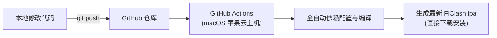

# FlClash for iOS

### 专为 iOS 深度定制的新一代高性能代理客户端

基于 **Mihomo (Clash.Meta)** 核心与 **Flutter** 现代化架构，纯净开源、无广告、极速低耗、丝滑质感。

[English](README.md) · **简体中文**

 

 

[📱 界面预览](#-界面预览) · [✨ 核心特性](#-核心特性) · [📥 安装指南](#-安装指南) · [🌐 协议支持](#-全协议支持矩阵) · [🛠️ 编译与打包](#️-云端自动构建-cicd)

---

## 📱 界面预览

  <table border="0">
    <tr>
      <td align="center" width="33%">
        
         
        <b>仪表盘主页 & 悬浮灵动 Dock</b> 
        实时速率 · 策略分流 · 便捷总控
      </td>
      <td align="center" width="33%">
        
         
        <b>波浪状态卡片 & 节点质量</b> 
        精美曲线底纹 · 住宅/数据中心智能标注
      </td>
      <td align="center" width="33%">
        
         
        <b>实用工具箱 & 进阶设置</b> 
        DNS 解析 · 连接审计 · 备份与多语言
      </td>
    </tr>
  </table>

---

## 🌟 核心特性

- 🍏 **原生 iOS NetworkExtension 深度优化**  
  基于 Apple 官方网络扩展框架打造，专门针对 iOS 系统严格的内存限制（Jetsam 机制）进行内存压制与泄漏控制，告别长时间后台运行被系统强制击杀闪退与断流。

- 🛡️ **回环防护与本地直连 (Loopback Support)**  
  原生排除本地回环（`127.0.0.1`）与本地网络保留地址，完美支持 **LiveContainer**、**SideStore** 免证书沙盒调试，杜绝自身连接死锁。

- 🚀 **智能防封订阅导入 (Anti-403 Forbidden)**  
  内置智能多级 User-Agent 伪装回退机制（通用 Clash Verge / Safari / Shadowrocket / Clash.Meta 自动回退），完美通过各大机场面板（V2Board、XBoard、SSPanel）及 Cloudflare WAF 白名单校验，彻底解决订阅添加 403 报错。

- 🎯 **极致平滑微动效 (Fluid Micro-Interactions)**  
  全面优化开关切换动画，采用丝滑的三次贝塞尔平滑缓动曲线，杜绝生硬回弹与变形跳动；工具页面进入时自动定位顶部，交互自然舒适。

- 🎨 **Apple 原生风格现代美学**  
  彻底剔除测试预览红带子（No PRE Banner），画面纯净无瑕。严格遵循 iOS Human Interface Guidelines，精雕细琢的连续曲率圆角、灵动悬浮底栏与自适应暗色模式。

- ⚡ **强大的 Mihomo (Clash.Meta) 全功能**  
  支持规则分流、策略组测速、DNS 流量控制、TUN 高性能模式、外部规则集（Rule-Set）、模块拓展与重写脚本。

---

## 📥 安装指南

本仓库通过 GitHub Actions 全自动编译生成未签名的标准 iOS 应用安装包（`.ipa`），支持多种主流安装方式：

### 方式 1：LiveContainer 免签名直接使用（推荐 ⭐⭐⭐⭐⭐）
> **优势**：完全不需要电脑自签，没有 7 天证书过期掉签烦恼，随时随地可用！
1. 在 iPhone / iPad 上安装好 [LiveContainer](https://github.com/khanld/livecontainer)。
2. 从本仓库 [Actions 产物](#️-云端自动构建-cicd) 或 Releases 中下载 `.ipa` 文件至手机「文件」App。
3. 打开 LiveContainer，点击右上角 **「+」** 号，选取该 `.ipa` 文件，即可直接免签名启动！

### 方式 2：TrollStore (巨魔商店) 永久安装（越狱 / 巨魔用户推荐）
1. 在已安装 TrollStore 的设备上直接下载 `.ipa`。
2. 使用 TrollStore 打开该 `.ipa`，点击 **Install** 即可永久免重签名使用。

### 方式 3：个人免费证书 / 开发者证书自签安装
1. **手机端自签工具**（轻松签 ESign、全能签、GBox、牛蛙助手等）：
   - 将 `.ipa` 发送至手机并使用自签工具打开，导入您自己的苹果证书，点击「立即签名并安装」。
2. **电脑端签名工具**（爱思助手、AltStore、Sideloadly）：
   - 手机连接电脑，打开签名工具添加 `.ipa` 文件，输入 Apple ID 自签安装。

### 方式 4：SideStore / AltStore 安装
直接将下载的 `.ipa` 文件导入 SideStore / AltStore 的应用列表中进行签名安装。

---

## 🌐 全协议支持矩阵

底层集成了全功能的 Mihomo 现代内核，涵盖目前所有主流与最新防封代理协议：

| 协议分类 | 支持协议 | 传输伪装与特性 |
| :--- | :--- | :--- |
| **新一代极速协议** | **Hysteria 2 / Hy2**、Hysteria 1、**TUIC v4 / v5** | 基于 UDP / QUIC 打造，端口跳跃、BBR 拥塞控制、抗弱网抖动 |
| **主流核心防封** | **VLESS**、**VMess** | 完整支持 **Reality**（最新防探测伪装）、Vision、gRPC、WebSocket、H2、HTTPUpgrade |
| **经典加密代理** | **Trojan**、**Shadowsocks (SS)**、**ShadowsocksR (SSR)** | 支持 SIP002、AEAD 2022、Shadow-TLS、v2ray-plugin、simple-obfs |
| **点对点与隧道** | **WireGuard / AmneziaWG**、**Snell (v1~v4)**、**SSH** | 支持预共享密钥 (PSK)、Reserved 混淆字节、AWG 自定义握手包 |
| **通用与新兴协议** | **SOCKS5**、**HTTP / HTTPS**、**AnyTLS**、**Mieru** | 纯净代理协议与新兴抗审查通道 |
| **订阅格式兼容** | **Clash YAML**、**Base64 批量节点**、**一键唤起链接** | 自动识别并转换 V2RayN Base64 订阅文本为完整 Clash 配置 |

---

## 🛠️ 云端自动构建 (CI/CD)

本项目原生接入 **GitHub Actions**，完全免除在本地配置苹果编译环境的麻烦：

### 如何触发打包与下载最新 IPA：
1. 打开您的 GitHub 仓库页面，点击顶部的 **「Actions」** 选项卡。
2. 在左侧选择 **「Build iOS IPA」** 工作流。
3. 点击右侧的 **「Run workflow」** 蓝色按钮即可开始自动云端打包。
4. 打包完成后，进入当次记录的 **Artifacts** 区域即可一键下载最新未签名的 `.ipa` 安装包。

---

## 📄 开源许可证

本项目基于 [GPL-3.0 License](LICENSE) 开源。
